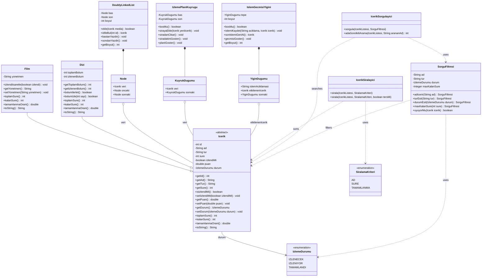

# dizivefilmtakipuygulamasi
veri yapıları dönem sonu projesi/dizivefilmtakipuygulamasi
 bu proje, kullanıcıların izledikleri ve izleyecekleri film ile dizileri kişisel bir arşivde düzenli şekilde tutmalarını, izleme planı oluşturmalarını, bölüm ilerlemelerini kaydetmelerini ve içerikleri filtreleyip sıralamalarını sağlayan bir masaüstü uygulamasıdır. dış katalog bağlantısı olmadan kullanıcı verileri doğrudan sisteme elle girilir.

## kullanılan teknolojiler
**programlama dili:** java
**arayüz:** javafx/swing

## ekip üyeleri, görev dağılımı ve veri yapıları
1.*Elif Şira BARCA (@elifsirabarca)*

   **kılavuzdaki rolü:** kaydetme ve arşiv yönetimi
   
   **kullandığı veri yapısı:** çift yönlü bağlı liste (doubly linked list)
   
   **tercih gerekçesi:** arşivdeki içerikler arasında hem ileriye hem geriye doğru rahatça gezinebilmek ve aradan bir film silindiğinde dizilerdeki gibi diğer elemanları tek tek kaaydırmak zorunda kalmamak
   
2.*Esmanur KALALI (@Esmanur)*

   **kılavuzdaki rolü:** silme ve izleme planı yönetimi
   
   **kullandığı veri yapısı:** kuyruk (custom queue)
   
   **tercih gerekçesi:** izleme planı mantıken bir sıradır. listeye ilk eklenen içeriğin ilk sırada izlenmesi kuralına (ilk giren ilk çıkar) tam uyduğu için kuyruk yapısı seçilmiştir.
   
3.*Filiz BAYIR (@filizbayir)*

   **kılavuzdaki rolü:** güncelleme ve durum takibi (geri alma)
   
   **kullandığı veri yapısı:** bağlı liste tabanlı yığın 
   
   **tercih gerekçesi:** kullanıcının yaptığı son değişikliği veya son izlediği içeriği en üstte tutmak, hatalı bir işlem yapıldığında ise son durumu kolayca geri alabilmek (son giren ilk çıkar) için yığın yapısı tercih edilmiştir.
   
4.*Leyla Nur KÖSE (@Leylanur)*

   **kılavuzdaki rolü:** sıralama ve sorgulama
   
   **kullandığı veri yapısı:** sıralama algoritması ve filtreleme
   
   **tercih gerekçesi:** arşivdeki içerikleri sürelerine, bölüm sayılarına veya ada göre düzenli dizmek ve ayrıca kullanıcının seçtiği türe göre listeyi filtreleyebilmek için temel sıralama ve arama yöntemleri kullanılacaktır.
   
## temel sınıf taslağı
 **Media(temel sınıf):** 'id', 'ad', 'tur', 'sure', 'izlendiMi', 'puan'
 
 **Film sınıfı:** Media sınıfından türer, 'yonetmen' bilgisi içerir.
 
 **Dizi sınıfı:** Media sınııfından türer, 'toplamBolum' ve 'izlenenBolum' bilgisi içerir.

## işleyiş ve kurallar
  *izlenen bölüm sayısı toplam bölüm sayısını kesinlikle aşamaz.
  
  *aynı içerik aktif izleme planına ikinci kez eklenemez.
  
  *sistemden bir içerik tamamen silinirken önce aktif planda aranır ve varsa plandan düşürülür, ardından ana arşivden kaldırılır.

  classDiagram
    direction TB

## yapay zeka kullanım beyanı
projenin planlama, mimari tasarım ve görev dağılımı aşamalarında yapay zeka araçlarından bir fikir danışmanı olarak yararlanılmıştır. tüm veri yapı sınıfları, algoritmalar ve test kodları ekip üyeleri tarafından bizzat yazılarak ve kavranarak projeye aktarılmaktadır.
